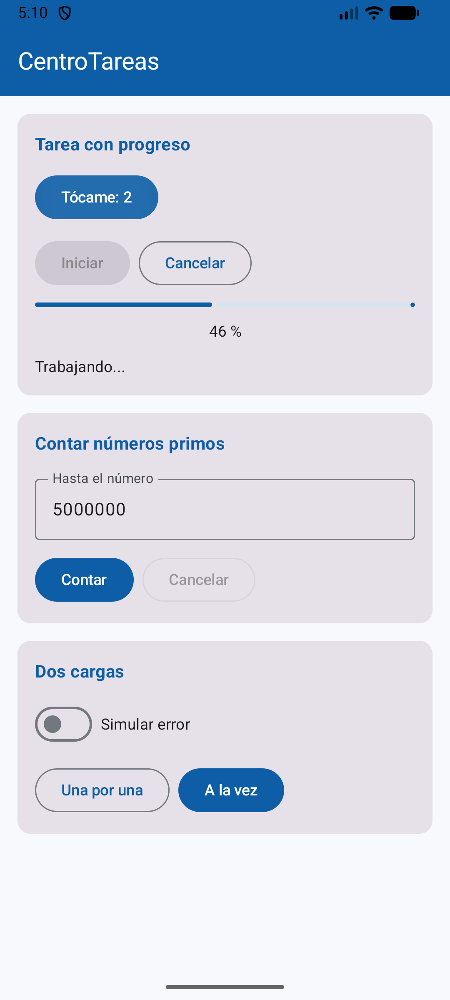
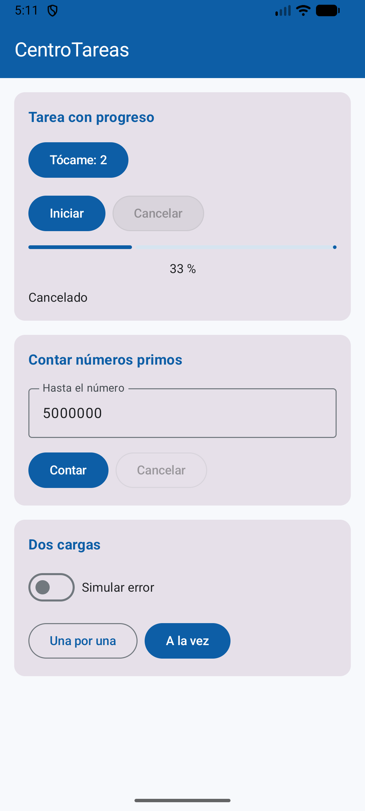
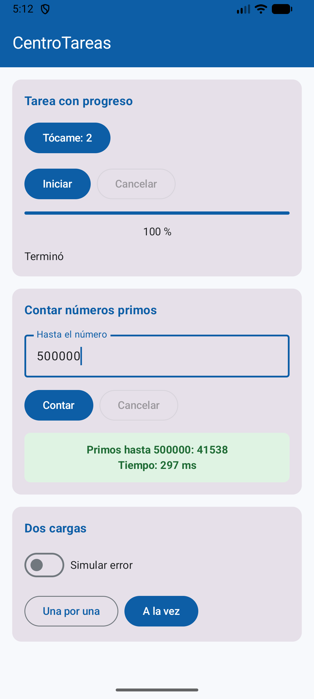
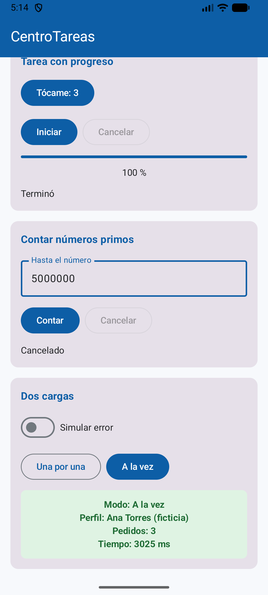
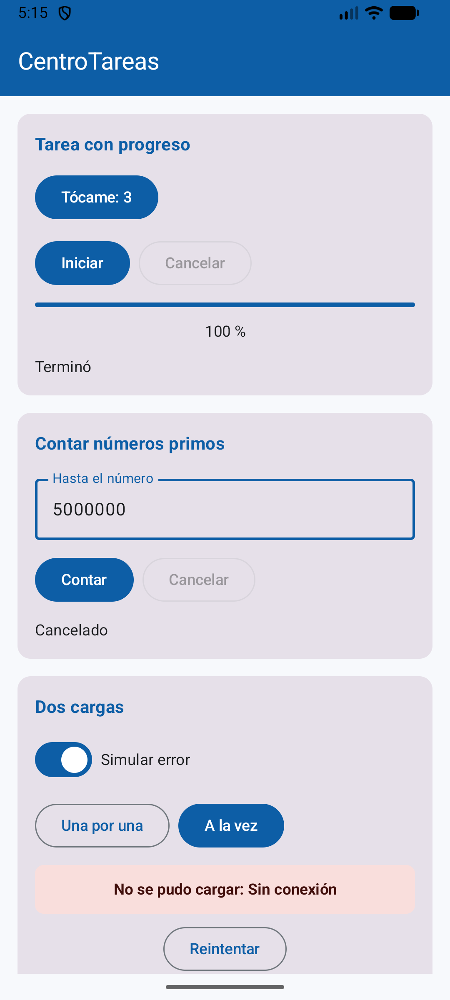
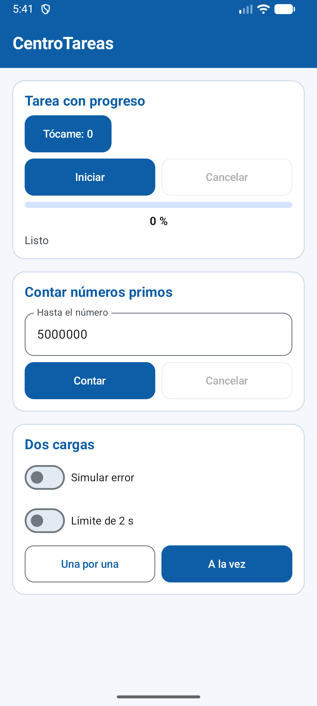
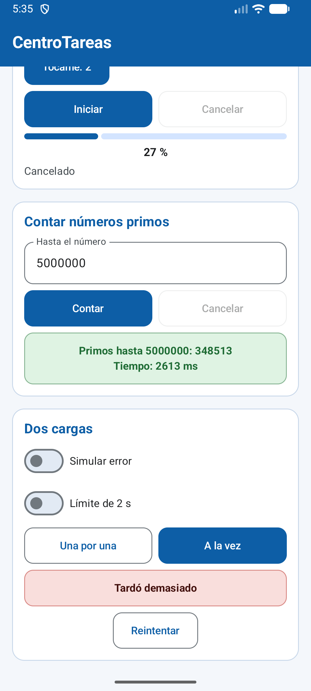
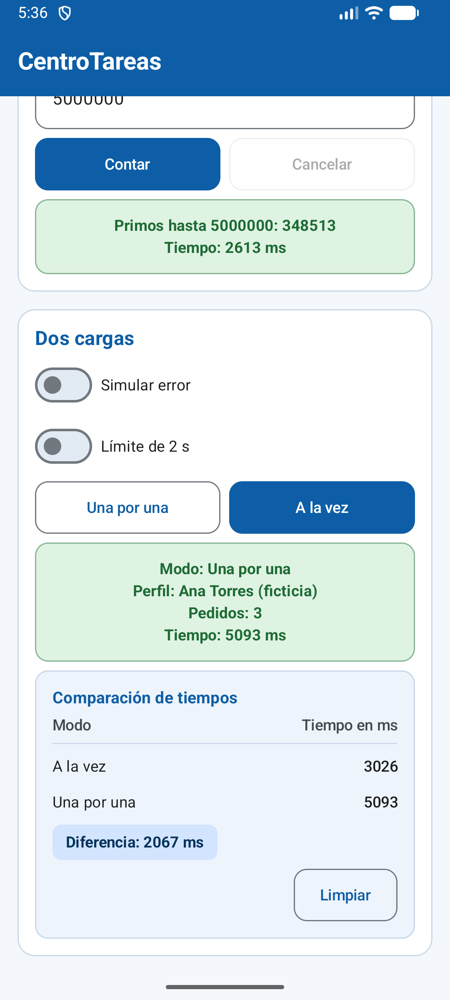

# CentroTareas

App Android del Laboratorio 14 de **Programación en Móviles** (Tecsup). Está construida con
Kotlin, Jetpack Compose y Material 3, sin XML, y usa corrutinas, `ViewModel` y el patrón
**MVVM + Repository** con una interface. Todos los datos son ficticios.

El objetivo es demostrar, con tres tareas que tardan, que el hilo principal nunca se bloquea:

- Una tarea con barra de progreso que se puede cancelar.
- Un cálculo pesado (contar números primos) que corre en `Dispatchers.Default`.
- Dos cargas simuladas que se comparan una por una contra en paralelo con `async`.
- Manejo de errores y reintento sin cerrar la app.

La rama `Sin_IA` contiene la Fase 1. La rama `Con_IA` parte de esa base y agrega cuatro
mejoras: el progreso nace en el Repository como `Flow`, las cargas se pueden limitar con
`withTimeout`, una tabla acumula los tiempos de los dos modos y la interfaz se rediseñó con
criterios de accesibilidad. El detalle de los prompts está en [PROMPTS.md](PROMPTS.md).

## Tecnologías

- Kotlin 2.0.21 y AGP 8.13.2.
- Jetpack Compose + Material 3 (Compose BOM 2024.09.00).
- `lifecycle-viewmodel-compose` 2.8.7.
- Corrutinas de Kotlin: `viewModelScope`, `launch`, `withContext`, `async`, `withTimeout`, `Job`.
- `StateFlow` para el estado que observa la pantalla y `Flow` con `flowOn` para el progreso.

## Árbol de paquetes

```text
Semana_14/Con_IA/centrotareas/
├── README.md
├── PROMPTS.md
├── docs/
│   └── capturas/
│       ├── 01_tarea_progreso.png
│       ├── 02_cancelada.png
│       ├── 03_primos.png
│       ├── 04_una_por_una_vs_a_la_vez.png
│       ├── 05_error.png
│       ├── fase2_ui.png
│       ├── fase2_tiempo_agotado.png
│       └── fase2_comparacion.png
└── app/src/main/java/com/correa/centrotareas/
    ├── MainActivity.kt
    ├── model/
    │   ├── Estados.kt                  (PrimosUi, CargaUi)
    │   └── RegistroTiempo.kt           (modo y milisegundos)
    ├── data/
    │   ├── TareasRepository.kt         (interface con Flow de progreso)
    │   └── TareasRepositoryLocal.kt    (flow + flowOn, cargas y contarPrimos)
    ├── viewmodel/
    │   ├── TareasViewModel.kt          (estado, cancelación y withTimeout)
    │   └── TareasViewModelFactory.kt   (crea el ViewModel con el Repository)
    └── ui/
        ├── PantallaTareas.kt           (Compose: las tres tarjetas y la tabla)
        └── theme/
            ├── Color.kt
            ├── Theme.kt
            └── Type.kt
```

## Arquitectura MVVM + Repository

```text
                 eventos (botones)                 collectAsState()
 View  ────────────────────────────────►  ViewModel  ──────────────►  View
 (PantallaTareas)                         (TareasViewModel)            (Compose)
                                               │
                                               │ viewModelScope.launch { ... }
                                               │ StateFlow<...> de solo lectura
                                               ▼
                                    TareasRepository (interface)
                                               │
                                               ▼
                              TareasRepositoryLocal (datos ficticios)
```

Reglas que respeta el proyecto:

- La **View** solo conoce a su `ViewModel`; no lanza corrutinas ni usa `Thread`.
- El **ViewModel** solo conoce la interface `TareasRepository`; no recibe `Context` ni
  conoce Composables. Recoge el `Flow` de progreso y lo convierte en `StateFlow`.
- El **Repository** no expone estados de pantalla; solo devuelve datos, emite progreso o lanza
  errores. `tareaConProgreso()` es un `Flow<Float>` que corre en `Dispatchers.Default` con
  `flowOn`.

## Mejoras de la Fase 2 (rama `Con_IA`)

Se eligieron **cuatro** mejoras de la lista del Word. Tres cambian Repository o ViewModel y una
cambia solo la UI.

### 1. Progreso desde el Repository con `Flow`

`TareasRepository.tareaConProgreso()` ahora devuelve `Flow<Float>`. La implementación emite 100
valores, uno cada 40 ms, y declara `flowOn(Dispatchers.Default)`; el ViewModel lo recoge con
`collect` dentro de `viewModelScope` y actualiza el `StateFlow` de la barra. Así el progreso ya no
se calcula en el ViewModel y el hilo de trabajo queda explícito en el Repository.

En Logcat, con el filtro `HILO`, se ve `Antes: main`, `Dentro: DefaultDispatcher-worker-*` y
`Despues: main`. La tarea dura ≈4 s y el botón **Cancelar** cancela el `Job`, detiene la barra y
deja el mensaje **Cancelado**.

### 2. Tiempo máximo con `withTimeout`

Cada carga se envuelve en `withTimeout(2000)` **solo cuando el interruptor «Límite de 2 s» está
activo**. Si el perfil o los pedidos no terminan en ese plazo, la pantalla muestra el recuadro
rojo **Tardó demasiado** con el botón **Reintentar**. El `catch` de
`TimeoutCancellationException` va antes del de `CancellationException`, y este último siempre se
relanza con `throw e`.

El límite no está fijo a propósito: las cargas normales tardan 2 s y 3 s, así que si estuviera
siempre activo la demo de éxito nunca se podría ver. Con el interruptor apagado se conserva el
comportamiento original.

### 3. Comparación de tiempos

Cada carga exitosa agrega un `RegistroTiempo(modo, milisegundos)` a un `StateFlow` del ViewModel.
La tarjeta muestra una tabla que acumula todas las filas, una etiqueta con la diferencia entre el
último tiempo de **Una por una** y el último de **A la vez**, y el botón **Limpiar**. Los intentos
fallidos o con tiempo agotado no se registran porque no tienen un tiempo comparable.

### 4. Interfaz rediseñada

Se aplicó la skill **UI/UX Pro Max** como guía y luego se adaptó al azul del laboratorio:

- Se corrigieron los tokens `surfaceContainer*` de Material 3, que eran la causa de las tarjetas
  lilas; ahora las tarjetas son blancas (claro) o gris azulado (oscuro) con borde y sin sombra.
- Barra superior azul con título blanco e íconos de estado claros; títulos de tarjeta y de la tabla
  en azul; recuadro verde para el éxito y rojo para el error con **Reintentar**.
- Objetivos táctiles de al menos 48 dp en botones, filas de interruptores e interruptores; toda la
  fila del interruptor es clicable con rol `Switch`.
- Espaciado en múltiplos de 8 dp, esquinas de 12/16 dp y jerarquía tipográfica con
  `headings` de accesibilidad.
- El porcentaje y la barra se animan 180 ms con `animateFloatAsState`; los estados aparecen y
  desaparecen con `AnimatedVisibility`. La tabla, el porcentaje y el botón **Tócame** siguen
  existiendo en el mismo orden.
- Modo claro y oscuro con contraste AA, y la rotación conserva el estado: `Tócame`, el N
  consultado y los toques usan `rememberSaveable`; el progreso, el resultado y la tabla viven en
  el ViewModel.

## Observación del Paso 1

Al pulsar **Tarea larga (MAL)** la pantalla se queda congelada durante 4 segundos. El botón
**Tócame** deja de sumar y no responde a los toques, la barra superior tampoco reacciona y el
texto **Trabajando...** no llega a verse. Esto ocurre porque `tareaLargaMala()` se ejecutaba en
el hilo principal: primero cambiaba el mensaje, pero ese cambio solo quedaba en memoria;
después ese mismo hilo pasaba 4 segundos ocupado y no podía dibujar la pantalla ni atender los
eventos táctiles. Cuando por fin terminaba, el hilo volvía a estar libre y dibujaba el estado
final, que ya decía **Terminó**. Por eso el usuario nunca alcanzaba a ver el estado intermedio.

Si la espera fuera de 10 segundos, Android mostraría el diálogo **«La aplicación no responde»
(ANR)**, porque el hilo principal habría estado bloqueado más tiempo del que el sistema tolera
para atender la entrada del usuario (unos 5 segundos). La app no se cerraría sola en ese
instante, pero el sistema ofrecería cerrarla o esperar.

> En el código final `tareaLargaMala()` ya no existe: el Paso 2 la reemplazó por `tareaLarga()`,
> que usa `viewModelScope.launch` y `withContext(Dispatchers.Default)`.

## Capturas

| Captura | Qué muestra |
| --- | --- |
|  | Tarea al 46 % con «Trabajando...»; **Iniciar** deshabilitado, **Cancelar** habilitado y **Tócame** subiendo mientras la tarea corre. |
|  | Tarea cancelada al 33 %: la barra se queda donde estaba, el texto dice «Cancelado» y **Iniciar** vuelve a estar habilitado. |
|  | Resultado de 500 000: 41 538 primos en 297 ms, en el recuadro verde. |
|  | Resultado de «A la vez»: 3025 ms. En la misma sesión, «Una por una» tardó 5091 ms. |
|  | Error simulado: recuadro rojo «No se pudo cargar: Sin conexión» y botón **Reintentar**. |

Las capturas se tomaron en el emulador **Medium_Phone_API_37.0** (1080 × 2400, 420 dpi).

Las capturas 01–05 son de la Fase 1 y muestran la interfaz anterior al rediseño; se conservan
como evidencia de las pruebas de esa fase.

### Capturas de la Fase 2

| Captura | Qué muestra |
| --- | --- |
|  | Pantalla inicial con la barra azul, tarjetas blancas, títulos azules y objetivos táctiles amplios. |
|  | «Límite de 2 s» activo: recuadro rojo **Tardó demasiado** y botón **Reintentar**. |
|  | Tabla con **A la vez** (3 026 ms) y **Una por una** (5 093 ms), la diferencia de 2 067 ms y **Limpiar**. |

## Resultados de referencia de los primos

| N | Primos | Tiempo medido en el emulador |
| --- | ---: | ---: |
| 100 | 25 | 4 ms |
| 1 000 | 168 | 23 ms |
| 10 000 | 1 229 | 44 ms |
| 100 000 | 9 592 | 135 ms |
| 500 000 | 41 538 | 297 ms |
| 5 000 000 | 348 513 | 2 809 ms |

El valor por defecto del campo es **5 000 000**. El Word pide ajustar el valor para que tarde
entre 2 y 5 segundos: con 500 000 este emulador tarda menos de 1 segundo, así que se subió el
valor por defecto a 5 000 000 (≈2,5 a 2,8 s). Los valores de referencia de la tabla se probaron
escribiendo cada N en el campo.

## Pruebas de aceptación

Todas las pruebas se ejecutaron en el emulador indicado, con la app instalada desde
`assembleDebug`.

| Prueba | Resultado esperado | Resultado obtenido | OK |
| --- | --- | --- | :-: |
| Tarea larga: tocar Tócame mientras trabaja | El contador sigue sumando | El contador pasó de 0 a 2 mientras la tarea estaba en «Trabajando...» | ✅ |
| Logcat con filtro HILO | `Sin_IA` antes y después; `DefaultDispatcher-worker` dentro | `Antes: main` → `Dentro: DefaultDispatcher-worker-2` → `Despues: main` (ver nota 1) | ✅ |
| Iniciar la tarea con progreso | La barra avanza de 0 a 100 % en ≈4 s | De 0 a 100 % en 4,44 s (marcas de tiempo del Logcat) | ✅ |
| Cancelar a mitad | La barra se detiene, dice Cancelado y se puede iniciar otra vez | Cancelada al 33 %; «Cancelado»; se reinició y volvió a avanzar | ✅ |
| Pulsar Iniciar dos veces seguidas | No se lanzan dos tareas | Un solo ciclo en el Logcat y **Iniciar** deshabilitado mientras corre | ✅ |
| Primos hasta 1000 | Resultado 168 | 168 en 23 ms | ✅ |
| Primos con N grande | La pantalla no se congela y Cancelar funciona | Con 5 000 000: «Tócame» sumó durante el cálculo y **Cancelar** dejó «Cancelado» | ✅ |
| Una por una | ≈5 s y resultado correcto | 5091 ms; Ana Torres (ficticia); 3 pedidos | ✅ |
| A la vez | ≈3 s y resultado correcto | 3025 ms; Ana Torres (ficticia); 3 pedidos | ✅ |
| Error simulado + Reintentar | Recuadro rojo; al desactivar el interruptor y reintentar, éxito | «No se pudo cargar: Sin conexión»; luego «A la vez» en 3044 ms | ✅ |
| Rotar la pantalla durante la tarea | La tarea continúa y el progreso no se reinicia | Al rotar seguía en 58 % con «Trabajando...»; luego llegó a 100 % y «Terminó» | ✅ |
| Revisar el código | `git grep` no encuentra `GlobalScope`, `runBlocking` ni `Thread.sleep` | `git grep -n -E "GlobalScope\|runBlocking\|Thread\.sleep" -- "*.kt"` sin resultados | ✅ |

**Nota 1.** El nombre real del hilo principal de Android es `main`, no `Sin_IA` (ese es el nombre
de la rama). El código registra `Thread.currentThread().name`, por eso el Logcat muestra `main`
antes y después, y `DefaultDispatcher-worker-2` dentro del `withContext`. No se cambió el nombre
del hilo de forma artificial.

### Pruebas de la Fase 2

Se ejecutaron con la APK de `assembleDebug` en el mismo emulador, después de cada commit.

| Prueba | Resultado esperado | Resultado obtenido | OK |
| --- | --- | --- | :-: |
| Progreso desde el Repository | La barra avanza y el log muestra el hilo de `Default` | De 0 a 100 % en 4,2 s; `Antes: main` → `Dentro: DefaultDispatcher-worker-2` → `Despues: main` | ✅ |
| Cancelar la tarea con `Flow` | La barra se detiene y se puede reiniciar | Cancelada al 27 %; «Cancelado»; **Iniciar** habilitado | ✅ |
| Límite de 2 s + Reintentar | «Tardó demasiado» y luego reintento exitoso | Con el límite activo apareció el recuadro rojo; al apagarlo y reintentar, «A la vez» en 3 002 ms | ✅ |
| Tabla de comparación | Acumula las filas y calcula la diferencia | 5 093 ms (una por una) y 3 026 ms (a la vez); diferencia 2 067 ms; tras otro reintento la diferencia se recalculó a 2 091 ms | ✅ |
| Limpiar | Vacía la tabla | La tabla desapareció y se pudo volver a llenar | ✅ |
| Error simulado + Reintentar | «Sin conexión» y luego éxito | «No se pudo cargar: Sin conexión»; al apagar el interruptor y reintentar, 3 002 ms | ✅ |
| Interfaz clara y oscura | Contraste AA, sin tarjetas lilas y barra azul | Revisada en modo claro y oscuro; títulos, textos, recuadros y estados legibles | ✅ |
| Rotación | Conserva el estado de la pantalla | En horizontal seguían «Tócame: 2», 27 %, «Cancelado» y el resultado de primos | ✅ |
| Revisar el código | Sin prohibidos | `git grep -n -E "GlobalScope\|runBlocking\|Thread\.sleep" -- "*.kt"` sin resultados | ✅ |

## Para pensar

**1. ¿Por qué no se veía «Trabajando...» en el Paso 1?**

Porque yo cambiaba el texto del mensaje y enseguida ejecutaba `Thread.sleep(4000)` en el hilo
principal. Cambiar el estado solo lo deja en memoria: para que se vea, Compose tiene que volver a
medir y dibujar, y eso también lo hace el hilo principal. Como ese hilo estaba ocupado durmiendo,
no podía dibujar nada hasta que terminara. Al final el mensaje ya era «Terminó», así que la
primera imagen que se dibujó fue la final. La pantalla no se refrescó en el intermedio.

**2. ¿Qué diferencia hay entre `Thread.sleep` y `delay`?**

`Thread.sleep` bloquea el hilo del sistema operativo: mientras duerme, ese hilo no ejecuta nada
más, ni otras corrutinas ni el dibujo de la pantalla. `delay` es una función `suspend`: suspende
la corrutina, libera el hilo para que haga otras cosas y programa la continuación para más tarde.
En la Fase 2 el `delay(40)` vive en `TareasRepositoryLocal.tareaConProgreso()`, dentro de un
`flow` con `flowOn(Dispatchers.Default)`: el hilo principal sigue libre y la barra se actualiza
entre vuelta y vuelta. En una app real el `delay` simula una operación que espera, no un bloqueo.

**3. ¿Por qué `Dispatchers.Default` para los primos y `Dispatchers.IO` para la red?**

Porque el trabajo es distinto. Contar primos gasta procesador: `Dispatchers.Default` tiene un
pool limitado al número de núcleos, pensado para cálculos. La red o el disco son operaciones de
entrada/salida que pasan mucho tiempo esperando: `Dispatchers.IO` tiene un pool más grande para
que muchas esperas no se coman los hilos de cálculo. En este laboratorio las cargas usan `delay`
y no bloquean, pero si `cargarPerfil()` y `cargarPedidos()` llamaran a Retrofit o a una base de
datos, lo correcto sería envolverlas en `Dispatchers.IO` (Retrofit ya lo hace por dentro).

**4. ¿Qué pasaría con la corrutina si el usuario cierra la pantalla? ¿Qué papel cumple `viewModelScope`?**

`viewModelScope` es un `CoroutineScope` atado al ciclo de vida del `ViewModel`. Cuando la
pantalla se cierra de verdad (por ejemplo, con el botón atrás o porque la Activity termina), el
`ViewModel` se destruye, el scope se cancela y las corrutinas que lanzó reciben la cancelación.
Por eso mis ciclos usan `delay` o `ensureActive()`: son puntos donde la corrutina puede
cancelarse. Si solo se **rota** la pantalla, la Activity se recrea pero el `ViewModel` se
conserva, así que `trabajo`, `progreso` y el estado siguen vivos y la tarea continúa. Esa es la
diferencia entre un cambio de configuración y cerrar la pantalla.

**5. ¿Por qué `async` tarda 3 s y no 5 s? ¿Qué pasa si una de las dos cargas falla?**

Porque las dos cargas arrancan al mismo tiempo dentro de `coroutineScope`: `async` lanza
`cargarPerfil()` (2 s) y `cargarPedidos()` (3 s) en paralelo, y el tiempo total es el máximo,
≈3 s, no la suma. Con llamadas secuenciales el total sería 2 s + 3 s ≈ 5 s. Si una falla,
`coroutineScope` cancela a la otra hija y relanza la excepción; en la Fase 2 mi `try/catch` de
`iniciarCarga()` atrapa primero `TimeoutCancellationException` (cuando el límite está activo),
después `CancellationException` y la vuelve a lanzar con `throw e`, y al final `Exception` para
mostrar «No se pudo cargar: ...». Así no queda una carga huérfana ni se cierra la app.

## Commits de la Fase 1 (rama `Sin_IA`)

| N | Mensaje |
| --- | --- |
| 1 | `chore: importa proyecto base CentroTareas` |
| 2 | `feat(hilos): provoca el congelamiento con Thread.sleep en el hilo principal` |
| 3 | `fix(hilos): mueve la tarea larga a una corrutina con withContext` |
| 4 | `feat(progreso): agrega barra de progreso con StateFlow` |
| 5 | `feat(cancelar): permite cancelar la tarea con Job` |
| 6 | `feat(primos): cuenta primos en Dispatchers.Default con cancelacion` |
| 7 | `feat(carga): compara carga secuencial y en paralelo con async` |
| 8 | `feat(errores): maneja errores de carga y agrega reintento` |
| — | `fix(primos): ajusta el valor por defecto y el rotulo del resultado` (corrección de auditoría) |
| 9 | `docs: agrega README con observaciones y capturas` |

## Commits de la Fase 2 (rama `Con_IA`)

| N | Mensaje |
| --- | --- |
| 1 | `chore: copia la Fase 1 de CentroTareas a la rama Con_IA` |
| 2 | `feat(flow): mueve el progreso de la tarea al Repository con Flow y flowOn` |
| 3 | `feat(timeout): agrega withTimeout en las cargas con aviso de tiempo agotado` |
| 4 | `feat(comparacion): agrega tabla que acumula los tiempos de una por una y a la vez` |
| 5 | `style(ui): mejora el diseno de la interfaz con UI/UX Pro Max` |
| 6 | `docs: agrega PROMPTS.md y actualiza el README con las mejoras de la Fase 2` |
