# AvisosCampus

AvisosCampus es una app Android del laboratorio de la semana 15 de Programación en Móviles. Usa Kotlin, Jetpack Compose y Material 3. Publica avisos locales, permite iniciar o cancelar un recordatorio de 10 segundos y escucha los cambios del modo avión cuando se activa el interruptor. El historial muestra los 20 avisos más recientes.

## Ejecutar el proyecto

1. Abre esta carpeta en Android Studio y selecciona el SDK instalado. El proyecto usa minSdk 24 y API 37.0 para compilar. El targetSdk es 37.
2. Arranca un dispositivo Android 13 o superior para probar el permiso de notificaciones.
3. Compila con `.\gradlew.bat :app:assembleDebug` o ejecuta la configuración **app**. En AvisosCampus toca **Permitir notificaciones**.

## Paquetes

```text
com.correa.avisoscampus/
├── AvisosApp.kt
├── MainActivity.kt
├── data/
│   ├── AvisosRepository.kt
│   ├── AvisosDatabase.kt
│   └── AvisosRepositoryRoom.kt
├── model/
│   └── Modelos.kt
├── notificacion/
│   └── Notificador.kt
├── receiver/
│   ├── CargadorReceiver.kt
│   └── ModoAvionReceiver.kt
├── ui/
│   ├── HistorialAvisos.kt
│   ├── PantallaAvisos.kt
│   └── theme/
└── viewmodel/
    ├── AvisosViewModel.kt
    └── AvisosViewModelFactory.kt
```

## Arquitectura MVVM

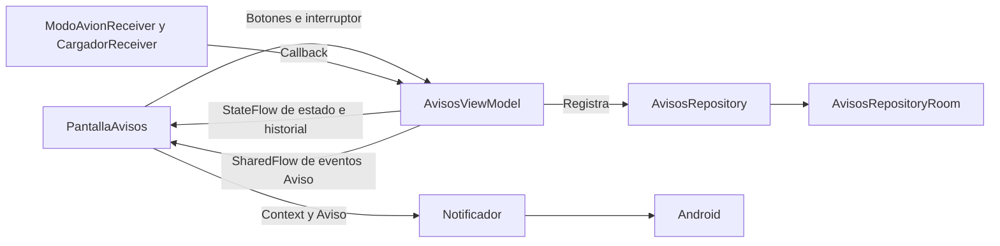

La pantalla conserva la colección de eventos al minimizarse para que el recordatorio pueda publicar mientras la actividad sigue viva. El ViewModel conserva el cronómetro y el historial en una rotación. La pantalla registra el receptor cuando se activa el interruptor y lo retira en `onDispose`.

## Capturas de la fase 1

| Notificación en el panel | Cuenta regresiva |
| --- | --- |
| 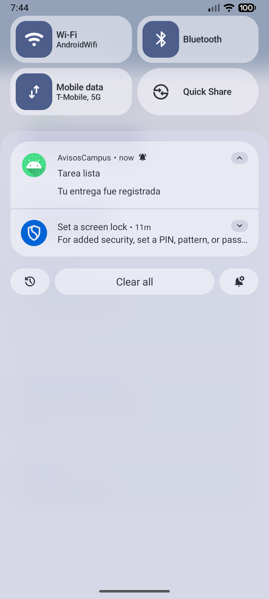 | 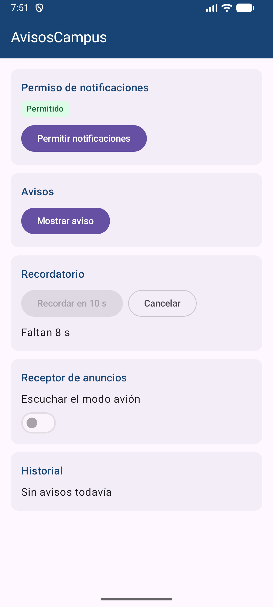 |
| **Aviso del modo avión** | **Historial de varios orígenes** |
| 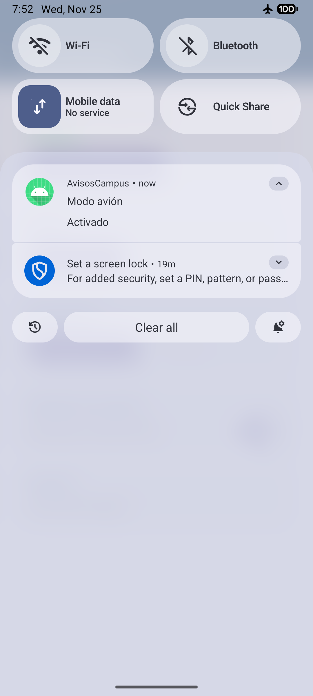 | 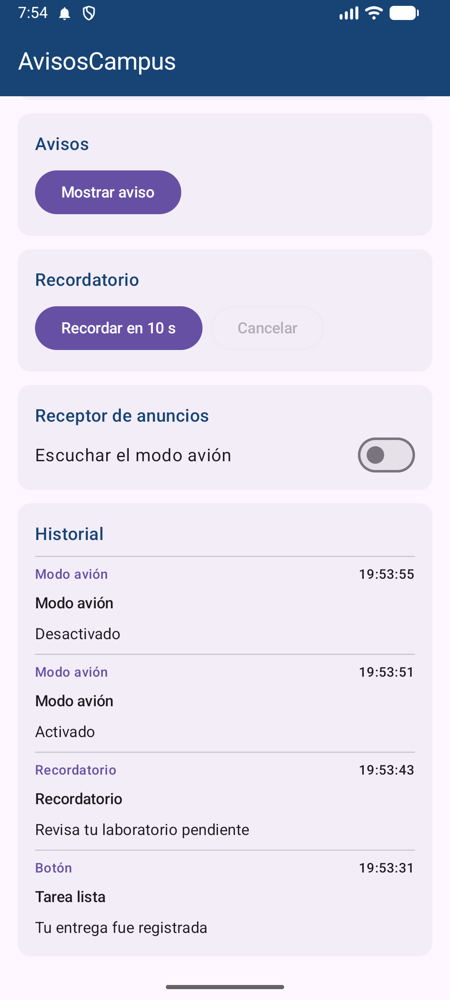 |
| **Permiso denegado** | |
| 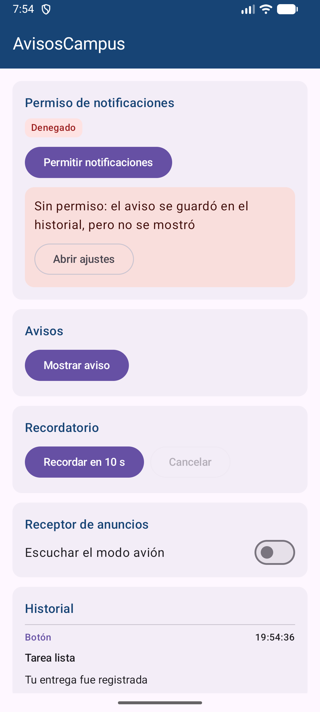 | |

## Pruebas de aceptación

Emulador visible `Medium_Phone_API_37.0`, API 37. Las capturas corresponden al APK de cada paso. El [registro de verificaciones](docs/capturas/verificacion_f1.txt) recoge las comprobaciones de ADB, la revisión de arquitectura y la repetición de las 13 pruebas con el APK final.

| N.º | Prueba | Resultado | Evidencia |
| --- | --- | --- | --- |
| 1 | Canal Avisos | ✅ | [Canal en la lista](docs/capturas/f1_01b_canal_lista.png), [detalle del canal](docs/capturas/f1_01_canal_avisos.png) y ADB |
| 2 | Cuadro de permiso y etiquetas | ✅ | [Cuadro](docs/capturas/f1_02_permiso_dialogo.png), [Permitido](docs/capturas/f1_03_permiso_permitido.png), [Denegado](docs/capturas/f1_03b_permiso_denegado_etiqueta.png) |
| 3 | Mostrar aviso | ✅ | [Tarea lista](docs/capturas/f1_04_notificacion_panel.png) |
| 4 | Dos avisos con ids distintos | ✅ | [Dos registros](docs/capturas/f1_05_dos_notificaciones.png) y ADB |
| 5 | Abrir y autocancelar al tocar | ✅ | [App abierta](docs/capturas/f1_06_notificacion_abre_app.png) y ADB |
| 6 | Cuenta regresiva y aviso | ✅ | [Cuenta](docs/capturas/f1_07_recordatorio_cuenta.png), [aviso](docs/capturas/f1_08_recordatorio_notificacion.png) |
| 7 | Recordatorio al minimizar | ✅ | ADB |
| 8 | Cancelar el recordatorio | ✅ | ADB |
| 9 | Modo avión activado y desactivado | ✅ | [Interruptor](docs/capturas/f1_09_modo_avion_switch.png), [aviso](docs/capturas/f1_10_modo_avion_aviso.png) y ADB |
| 10 | Interruptor apagado | ✅ | ADB |
| 11 | Permiso denegado e historial | ✅ | [Mensaje](docs/capturas/f1_12_permiso_denegado.png), [Ajustes](docs/capturas/f1_13_abrir_ajustes.png) y ADB |
| 12 | Rotación durante la cuenta | ✅ | ADB |
| 13 | MVVM y retiro del receptor | ✅ | Select-String y revisión de registro |

## Para pensar

### ¿Para qué necesita canal y permiso una notificación?

El canal agrupa los avisos y permite que el usuario controle su importancia y comportamiento desde Android 8.
Si la app apunta a Android 8 o superior y publica hacia un canal inexistente, el sistema descarta ese aviso.
El permiso de Android 13 habilita la publicación para la aplicación. Al denegarlo, el aviso de prueba quedó en el historial y el panel se mantuvo vacío.

### ¿Por qué el ViewModel emite un evento?

El ViewModel decide el título, el texto y el origen, guarda el aviso y emite un evento de una sola vez.
La pantalla lo recoge y entrega su `Context` a `Notificador`, que controla la API de Android.
Así se puede probar el ViewModel con un repositorio de prueba y se conserva el mismo modelo al rotar la actividad.

### ¿Qué ocurre si se reutiliza el id?

Android identifica cada notificación activa por la aplicación, la etiqueta opcional y el id.
Volver a publicar con la misma combinación actualiza la notificación activa correspondiente.
En el emulador, dos pulsaciones produjeron dos registros activos porque el repositorio asignó ids distintos.

### ¿Por qué debe ser corto `onReceive` y cuándo se retira el receptor?

Un receptor dinámico ejecuta `onReceive` en el hilo principal por defecto. Una operación larga puede bloquear la interfaz o provocar un ANR.
El receptor del laboratorio lee el estado del anuncio y lo delega al ViewModel mediante un callback.
`onDispose` lo retira al desactivar la escucha o al salir de composición, para liberar el registro y evitar callbacks duplicados al recrear la pantalla.

### ¿Cuándo usar una notificación local o una push de Firebase?

Una notificación local sirve para hechos que el teléfono puede detectar o calcular, como un recordatorio de 10 segundos o el modo avión.
Una push de Firebase Cloud Messaging sirve para eventos que se originan en un servidor, como un cambio en la fecha de entrega.
El laboratorio produjo sus avisos en el emulador. Una integración con FCM requeriría un emisor y conectividad.

## Fase 2 — Mejoras con IA

La base y las evidencias de la Fase 1 provienen de la rama `Sin_IA` del repositorio general. Los diez commits de esa fase se encuentran en `Sin_IA`. Consulta el [registro de IA](PROMPTS.md) y el [registro de verificaciones de la Fase 2](docs/capturas/verificacion_f2.txt).

| Mejora | Capas | Comportamiento verificado |
| --- | --- | --- |
| Canales Avisos y Urgentes | Modelo y Notificador | El modelo asigna el recordatorio a Urgentes. La importancia alta permite un emergente. El botón y los demás orígenes usan Avisos. |
| Texto expandido | Notificador | `BigTextStyle` proporciona el texto completo en la vista expandida. `dumpsys` contiene `android.bigText`. La diferencia visual es pequeña con el texto corto de la guía. |
| Receptor del cargador | Receiver, modelo, ViewModel y UI | Su interruptor registra un filtro para conexión y desconexión. El receptor emite por callback y el ViewModel registra el aviso. |
| Historial persistente | Repository, ViewModel y aplicación | Room asigna ids autoincrementales y recupera las filas en orden descendente. El ViewModel escribe en IO antes de emitir el aviso. |

### Capturas de la fase 2

| Inicio | Canales en Ajustes |
| --- | --- |
| 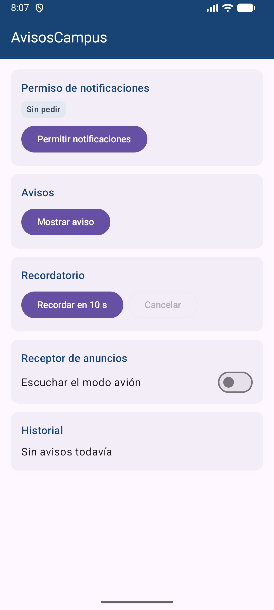 | 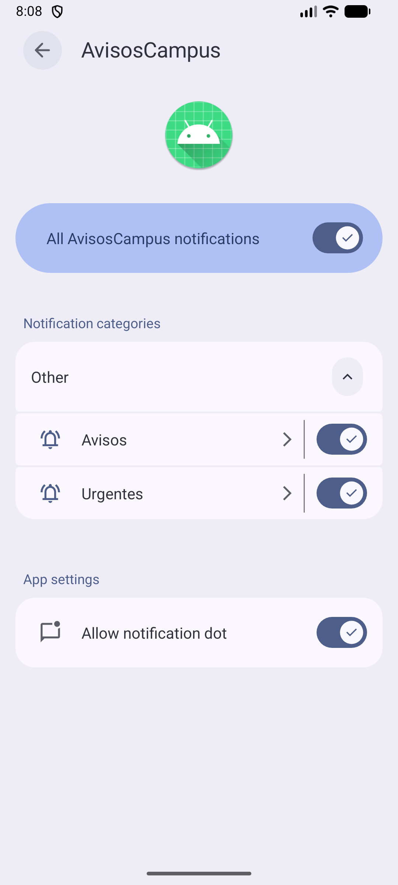 |
| **Recordatorio emergente** | **Notificación expandida** |
| 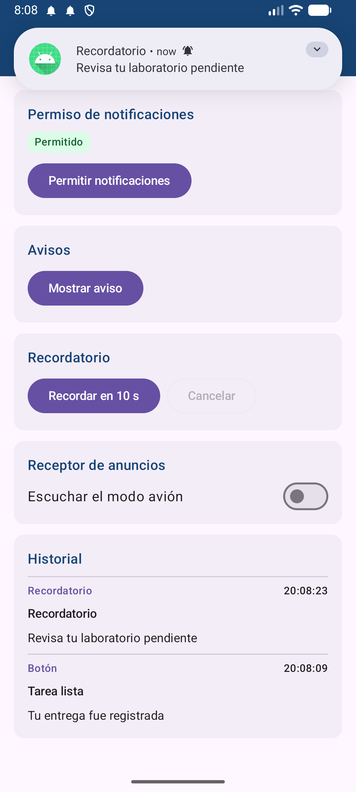 | 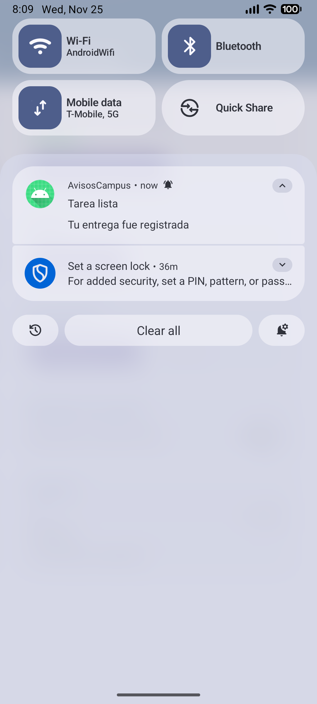 |
| **Interruptor del cargador** | **Aviso del cargador** |
| 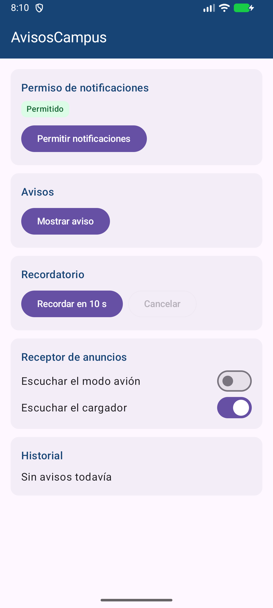 | 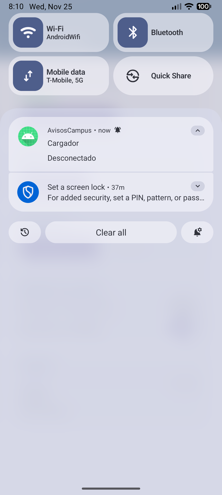 |
| **Historial tras reiniciar el proceso** | **Pantalla final** |
| 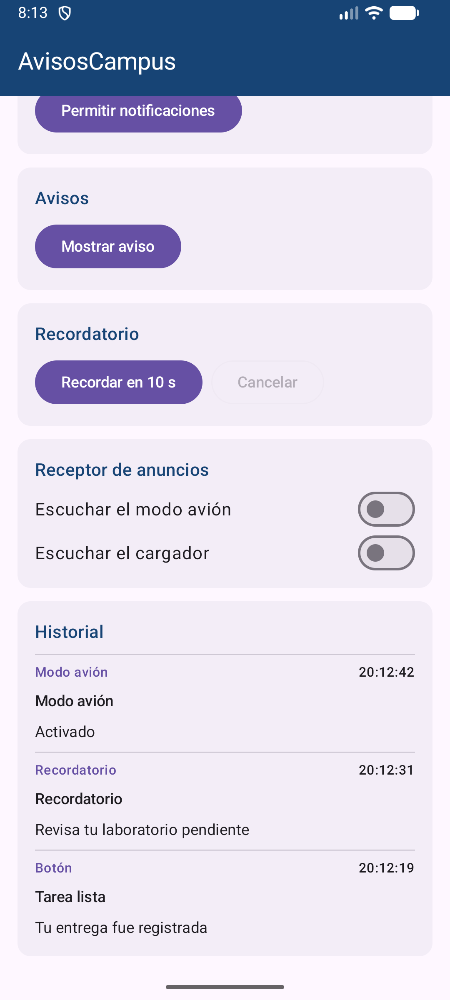 | 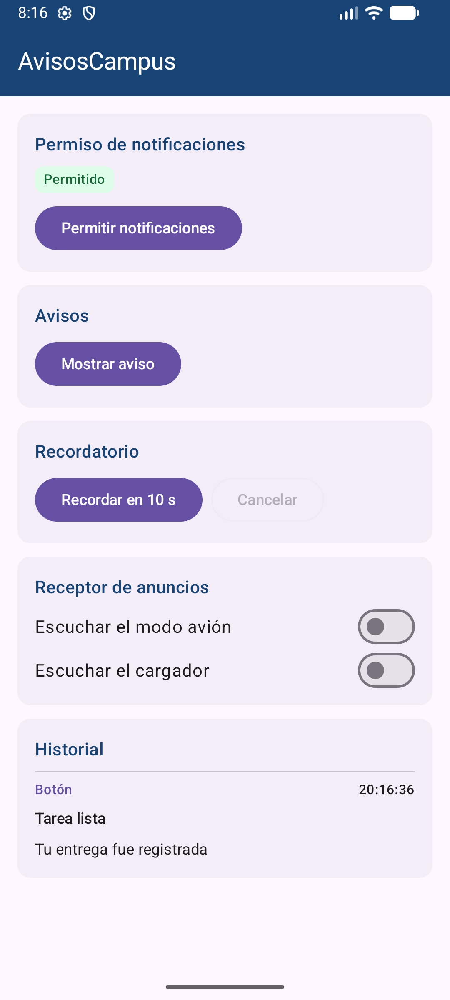 |

### Regresión

| N.º | Prueba | Resultado | Observación |
| --- | --- | --- | --- |
| 1 | Canal Avisos | ✅ | Canal Avisos en ajustes y mImportance=3 en dumpsys. |
| 2 | Cuadro de permiso y etiquetas | ✅ | Instalación limpia, diálogo real y etiqueta Permitido; denegación en prueba 11. |
| 3 | Mostrar aviso | ✅ | Tarea lista visible, id 1. |
| 4 | Dos avisos con ids distintos | ✅ | Dos NotificationRecord activos con ids [1, 2]. |
| 5 | Abrir y autocancelar al tocar | ✅ | MainActivity abierta y autocancelada con HOME y con HOME + am kill (1→0, 1→0). |
| 6 | Cuenta regresiva y aviso | ✅ | Cuenta observada 9→6; un aviso nuevo 3 al terminar. |
| 7 | Recordatorio al minimizar | ✅ | HOME durante la cuenta; nuevo NotificationRecord 4. |
| 8 | Cancelar el recordatorio | ✅ | Cancelar detuvo la cuenta; ids sin cambios: [3, 4] tras esperar más de 10 s. |
| 9 | Modo avión activado y desactivado | ✅ | Activado (1) y Desactivado (2); giro entre avisos. Método: mosaico de Configuración rápida. |
| 10 | Interruptor apagado | ✅ | El modo avión cambió con el switch apagado; ids sin cambios: [1, 2]. |
| 11 | Permiso denegado e historial | ✅ | Aviso guardado en historial, mensaje de error y cero notificaciones; Ajustes abre y al conceder se limpia el mensaje. |
| 12 | Rotación durante la cuenta | ✅ | En horizontal se observaron 6 s restantes; llegó el aviso 5. |
| 13 | MVVM y retiro del receptor | ✅ | Select-String: 0 coincidencias; 2 receptores se retiran en onDispose; FLAG_IMMUTABLE. |
