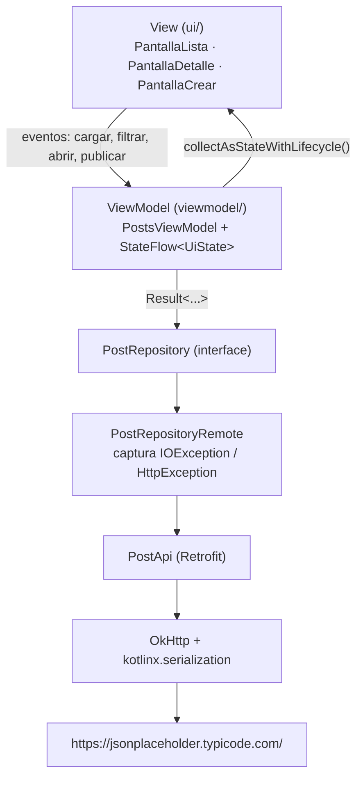
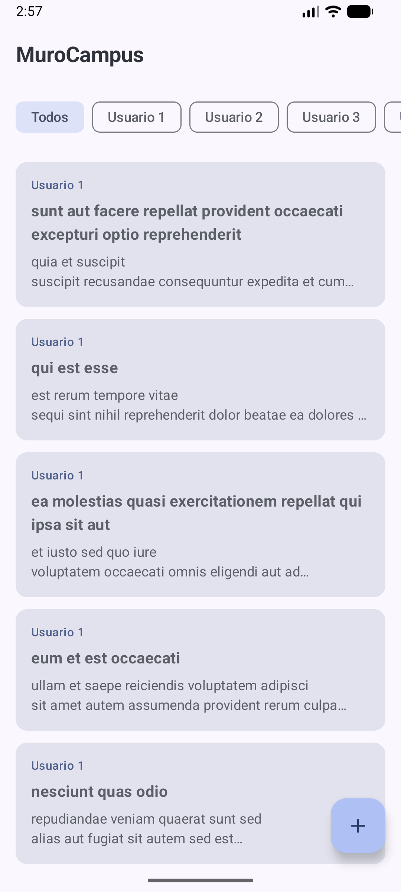
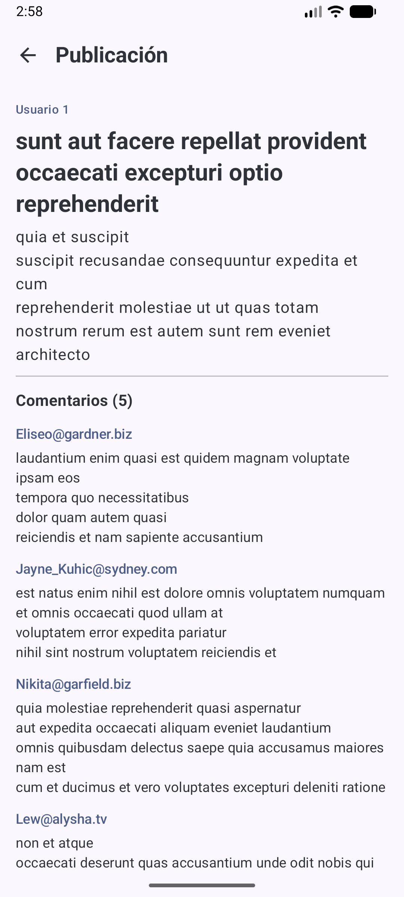
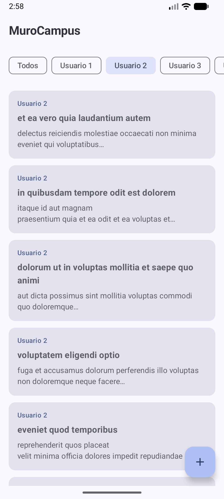
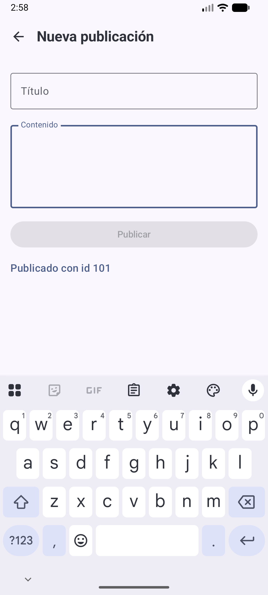
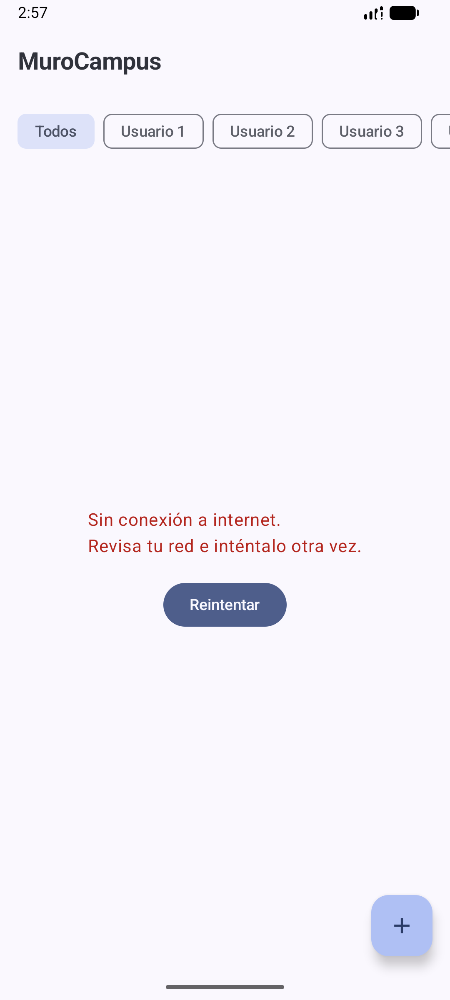

# MuroCampus

Aplicación Android desarrollada en Kotlin con Jetpack Compose para el laboratorio **GLAB-S09** de Programación en Móviles. Consume el servicio REST de [JSONPlaceholder](https://jsonplaceholder.typicode.com/) y funciona como un muro de publicaciones universitario: lista publicaciones, muestra el detalle con sus comentarios, filtra por usuario y crea una publicación nueva. También muestra estados claros de carga, error y lista vacía cuando la red falla.

## Funcionalidades

- Lista de las 100 publicaciones con etiqueta de usuario, título y resumen del contenido.
- Detalle de una publicación con su texto completo y sus comentarios (`Comentarios (N)`).
- Filtro por usuario mediante chips: `Todos`, `Usuario 1` … `Usuario 10`.
- Creación de una publicación con `POST` y cuerpo JSON; muestra `Publicado con id 101`.
- Manejo de errores de red y de servidor con mensaje y botón `Reintentar`.
- Estado `Sin publicaciones` cuando la lista recibida está vacía.
- Navegación por estado con `BackHandler`, sin perder el estado del ViewModel al rotar.

## Tecnologías

- Kotlin 2.0.21 y Jetpack Compose (Material 3).
- MVVM + Repository.
- Retrofit 2.11.0 + convertidor kotlinx.serialization.
- OkHttp 4.12.0 con `HttpLoggingInterceptor` (nivel `BODY`, solo para desarrollo).
- kotlinx.serialization 1.7.3 con `ignoreUnknownKeys = true`.
- `StateFlow` + `collectAsStateWithLifecycle()`.
- `Result<T>` como contrato entre Repository y ViewModel.

## Cómo compilar y ejecutar

Requisitos: Android Studio con JDK 17 o superior (el proyecto compila con JDK 21) y un emulador o dispositivo con internet.

```powershell
cd Semana_9\Sin_IA\murocampus
.\gradlew.bat assembleDebug
```

Luego instala `app\build\outputs\apk\debug\app-debug.apk` o ejecuta la configuración `app` desde Android Studio.

La URL base es `https://jsonplaceholder.typicode.com/` y se declara en `data/remote/RetrofitClient.kt`.

## Estructura de paquetes

```text
app/src/main/java/com/correa/murocampus/
├── MainActivity.kt                 Navegación por estado y BackHandler
├── model/
│   ├── Modelos.kt                  Post, Comentario y NuevoPost
│   └── Usuario.kt                  Ejemplo base de Usuario
├── data/
│   ├── MensajesDeError.kt          mensajeDe(Throwable) para la UI
│   ├── PostRepository.kt           Interface + PostRepositoryRemote
│   ├── UsuarioRepository.kt        Interface + UsuarioRepositoryRemote
│   └── remote/
│       ├── PostApi.kt              GET/POST de publicaciones
│       ├── UsuarioApi.kt           GET de usuarios
│       └── RetrofitClient.kt       Retrofit + OkHttp + JSON
├── viewmodel/
│   ├── UiState.kt                  Cargando / Exito / Error
│   ├── PostsViewModel.kt           lista, detalle, filtro y creación
│   └── PostsViewModelFactory.kt    Inyección del Repository
└── ui/
    ├── Componentes.kt              TarjetaPost, Cargando, ErrorConReintento
    ├── PantallaLista.kt            Chips, lista y FAB
    ├── PantallaDetalle.kt          Publicación y comentarios
    ├── PantallaCrear.kt            Formulario y resultado del POST
    └── theme/
        ├── Color.kt
        ├── Theme.kt
        └── Type.kt
```

`UsuarioApi`, `UsuarioRepository` y `Usuario.kt` forman el ejemplo base entregado por el profesor; se conservan para mostrar el mismo patrón que se aplicó a `Post`.

## Arquitectura MVVM + Repository



| Capa | Conoce a | No debe |
|---|---|---|
| View (`ui/`) | Solo a su ViewModel | Llamar a Retrofit ni conocer `PostApi` |
| ViewModel (`viewmodel/`) | Solo a la interface `PostRepository` | Conocer Retrofit, `HttpException` ni `Context` |
| Repository (`data/`) | `PostApi` y las excepciones de red | Conocer la UI ni dejar escapar excepciones: devuelve `Result` |
| `data/remote/` | Retrofit, OkHttp y el JSON | Guardar estado de pantalla |

El Repository relanza `CancellationException` antes de capturar `Exception`, para no tragarse la cancelación de una corrutina. La función `mensajeDe` vive en `data/MensajesDeError.kt` a propósito: es la única capa que conoce `HttpException`, y así `viewmodel/` permanece libre de detalles de Retrofit.

## Capturas

Todas las capturas se tomaron en el emulador `Medium_Phone_API_37` (1080 × 2400).

### Lista de publicaciones



### Detalle con comentarios



### Filtro por usuario



### Crear publicación



### Error de conexión



## Pruebas del Paso 10

Ejecutadas el **25/11/2026** sobre el APK `debug` en el emulador `Medium_Phone_API_37`, con internet real salvo en la prueba sin conexión. Los cambios temporales de las pruebas se revirtieron con `git restore` y no se commitearon.

| Prueba | Cómo se provocó | Resultado esperado | Resultado obtenido |
|---|---|---|---|
| Sin internet | Se desactivaron Wi-Fi y datos (`svc wifi disable` y `svc data disable`) y se abrió la app | `Sin conexión a internet` + `Reintentar` | **OK**: se mostró el mensaje y el botón |
| Reintentar | Se reactivaron Wi-Fi y datos y se pulsó `Reintentar` | Carga la lista | **OK**: cargaron las publicaciones sin reiniciar |
| Recurso inexistente | Cambio temporal de `abrir(id)` por `abrir(9999)` en `MainActivity` | `Error del servidor (404)` | **OK**: `GET posts/9999` devolvió 404 y la pantalla mostró el mensaje |
| JSON con un campo extra | Se quitó temporalmente `name` de `Comentario`; el JSON sí lo envía | Funciona por `ignoreUnknownKeys` | **OK**: el detalle siguió mostrando los 5 comentarios |
| JSON con un campo faltante | Se agregó temporalmente `val extra: String` a `Post`; el JSON no lo envía | `Respuesta inesperada` | **OK**: la lista mostró `Respuesta inesperada` |
| Cancelación | Se abrió el detalle y se volvió rápido con Atrás | Sin errores en Logcat | **OK**: no hubo `FATAL` ni excepciones sin capturar |
| Lista y detalle | Se abrieron varias publicaciones | Siempre 5 comentarios | **OK**: verificado en las publicaciones 1 y 20 |
| Filtro | Se eligió cada usuario del 1 al 10 | 10 publicaciones por usuario | **OK**: cada respuesta tuvo 10 elementos; en `Usuario 5` se contaron las 10 tarjetas en pantalla |
| Crear | Se llenaron Título y Contenido y se pulsó `Publicar` | `Publicado con id 101` | **OK**: el POST devolvió 201 y el mensaje mostró el id 101 |
| Publicar durante el envío | Se añadió un retardo temporal de 3 s en el ViewModel | Botón deshabilitado mientras `Cargando` | **OK**: el botón quedó gris y no clickeable con los campos llenos |
| Código del ViewModel | Búsqueda de `retrofit2`, `PostApi` y `HttpException` en `viewmodel/` | Sin coincidencias | **OK**: no hay ninguna coincidencia |
| Lista vacía | La API siempre devuelve 10 publicaciones por usuario | `Sin publicaciones` | **Implementado**; no se provocó desde la UI en la Fase 1 (se verifica con la búsqueda de la Fase 2) |

## Para pensar

### 1. ¿Qué diferencia hay entre GET y POST? ¿Por qué `crear` lleva `@Body` y `porUsuario` lleva `@Query`?

`GET` solicita o lee un recurso y no debería modificar el servidor; sus parámetros viajan en la URL. `POST` envía datos para crear un recurso y esos datos viajan en el cuerpo de la petición.

`crear` lleva `@Body` porque el servidor necesita recibir el objeto completo de la nueva publicación (`userId`, `title` y `body`) serializado como JSON. `porUsuario` lleva `@Query` porque solo está filtrando una colección existente: `userId` es un criterio que se agrega a la URL (`posts?userId=2`) y no un recurso nuevo.

### 2. ¿Por qué la ruta es `"posts"` y no `"/posts"`?

Porque la `baseUrl` es `https://jsonplaceholder.typicode.com/` y Retrofit resuelve una ruta relativa contra ella. Con `"posts"` la URL final es `https://jsonplaceholder.typicode.com/posts`. Si se usara `"/posts"`, Retrofit la interpretaría como una ruta absoluta desde la raíz del host y descartaría cualquier camino que tuviera la `baseUrl` (por ejemplo, si fuera `https://servidor.com/api/`, se perdería `/api/`). La forma relativa es la correcta y la que exige la guía.

### 3. ¿Por qué el Repository devuelve `Result` en vez de dejar que la excepción llegue al ViewModel?

Porque una llamada de red puede fallar por muchas razones (sin internet, timeout, 404, JSON inválido) y el ViewModel no debe conocer esos detalles ni tener que envolver cada llamada en `try/catch`. El Repository captura la excepción, relanza `CancellationException` y devuelve `Result.success` o `Result.failure`. Así el ViewModel solo transforma el resultado en `UiState` y la app no se cierra por una excepción no controlada. Además, el contrato `Result` permite cambiar la fuente de datos (por ejemplo, una caché local) sin tocar el ViewModel.

### 4. ¿Qué pasa si olvidas el permiso INTERNET? ¿Y si olvidas `ignoreUnknownKeys` y el servidor agrega un campo nuevo?

Sin `<uses-permission android:name="android.permission.INTERNET" />` la app compila y abre, pero ninguna petición sale: el sistema bloquea la red y la app muestra un error de conexión aunque el dispositivo tenga internet.

Sin `ignoreUnknownKeys = true`, kotlinx.serialization falla con `SerializationException` cuando el JSON trae un campo que no existe en la data class. La app mostraría `Respuesta inesperada` aunque los datos sean válidos. Con `ignoreUnknownKeys = true` los campos desconocidos se ignoran y la app sigue funcionando cuando el servidor evoluciona.

### 5. ¿Por qué la pantalla de lista usa un `when` sobre `UiState` y no un `if` con tres variables?

Porque `UiState` es una `sealed interface` con tres casos mutuamente excluyentes: `Cargando`, `Exito` y `Error`. El `when` obliga al compilador a verificar que se manejen todos los casos y hace imposible que la pantalla esté, por ejemplo, cargando y mostrando un error al mismo tiempo. Con tres variables booleanas se podrían dar combinaciones inválidas y habría que decidir manualmente cuál tiene prioridad, además de que el código sería más difícil de leer y de mantener.

### 6. JSONPlaceholder no guarda los POST. ¿Cómo cambiaría la app si usaras un servicio real?

Con un servicio real el `POST` persistiría la publicación y el servidor devolvería un id definitivo (no el 101 simulado). Después de crear, la app debería recargar la lista o insertar la publicación devuelta en el estado local para verla sin volver a descargar todo. También habría que manejar autenticación (token), validaciones del servidor, códigos 201/204, paginación, reintentos y, si se requiere funcionar sin internet, una caché local con Room. En JSONPlaceholder todo eso es simulado: el `POST` responde 201 con id 101, el `DELETE` responde 200 y ningún cambio se conserva al volver a consultar.

## Notas

- Rama de la Fase 1: `Sin_IA`.
- El servicio JSONPlaceholder **simula** las escrituras: `POST` y `DELETE` responden con éxito, pero no guardan cambios.
- `HttpLoggingInterceptor` está en nivel `BODY` únicamente para desarrollo; en producción conviene bajarlo o eliminarlo.
