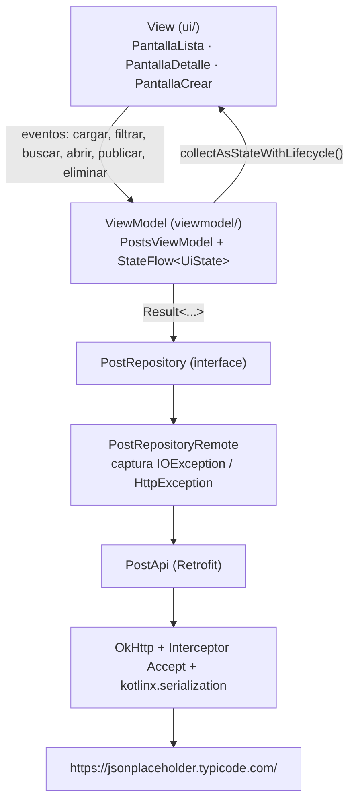
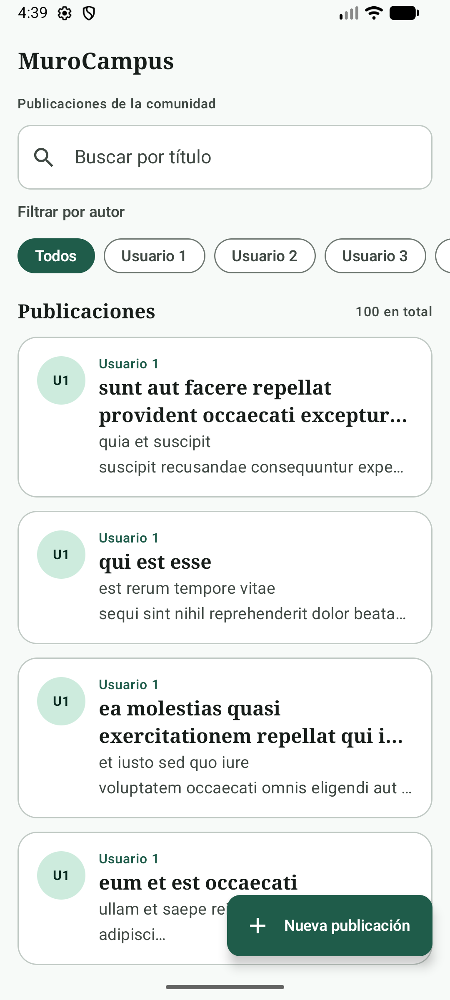
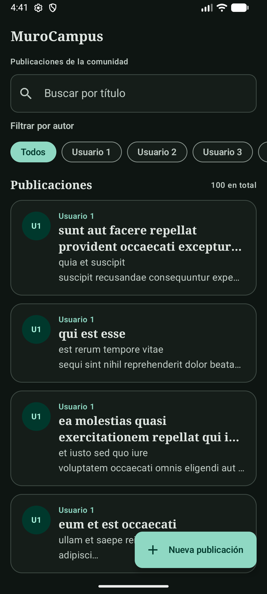
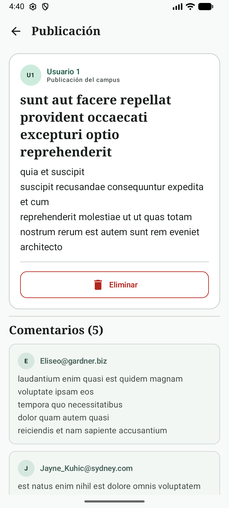
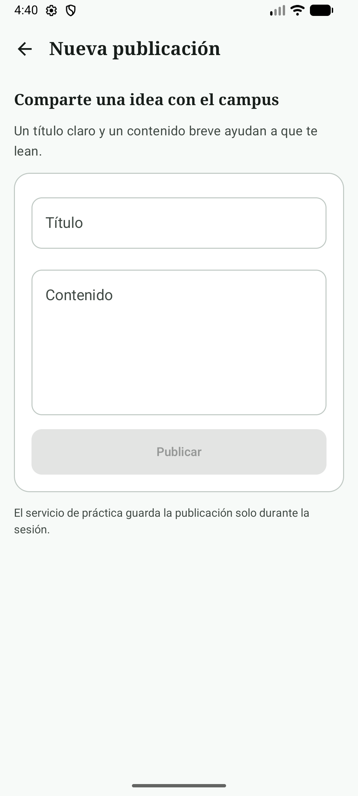
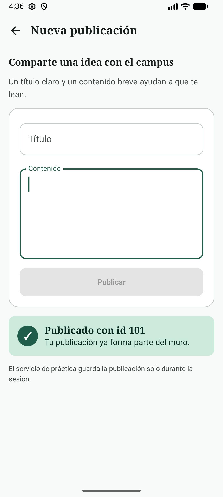
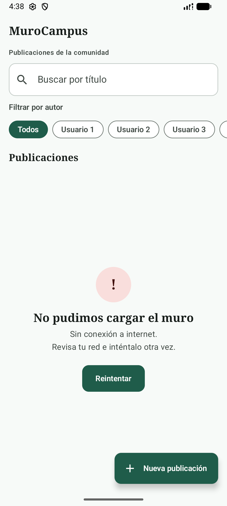

# MuroCampus

Aplicación Android desarrollada en Kotlin con Jetpack Compose para el laboratorio **GLAB-S09** de Programación en Móviles. Consume el servicio REST de [JSONPlaceholder](https://jsonplaceholder.typicode.com/) y funciona como un muro de publicaciones universitario.

La **Fase 1** quedó en la rama `Sin_IA`. La **Fase 2** vive en `Con_IA` y agrega cuatro mejoras sobre la misma base: encabezado `Accept: application/json` con un `Interceptor` de OkHttp, borrado con `DELETE`, búsqueda por título sobre la lista descargada y un rediseño visual con UI/UX Pro Max. El registro de prompts está en [PROMPTS.md](PROMPTS.md).

## Funcionalidades

- Lista de las 100 publicaciones con etiqueta de usuario, título y resumen del contenido.
- Detalle de una publicación con su texto completo y sus comentarios (`Comentarios (N)`).
- Filtro por usuario mediante chips: `Todos`, `Usuario 1` … `Usuario 10`.
- Búsqueda por título sobre la lista ya descargada, combinable con el filtro por usuario.
- Creación de una publicación con `POST` y cuerpo JSON; muestra `Publicado con id 101`.
- Borrado de una publicación con `DELETE` y confirmación previa; la tarjeta desaparece de la lista.
- Encabezado `Accept: application/json` agregado por un `Interceptor` de OkHttp.
- Manejo de errores de red y de servidor con mensaje y botón `Reintentar`.
- Estado `Sin publicaciones` cuando la búsqueda no encuentra coincidencias.
- Navegación por estado con `BackHandler`, sin perder el estado del ViewModel al rotar.
- Tema propio claro/oscuro, sin color dinámico, con tipografía editorial y controles táctiles de al menos 48 dp.

## Mejoras de la Fase 2

| Mejora | Implementación | Evidencia |
|---|---|---|
| Encabezado `Accept` | `RetrofitClient` agrega un `Interceptor` antes del logger. | Logcat muestra `Accept: application/json` en las peticiones. |
| Borrado | `PostApi.borrar()` usa `@DELETE` y `Response<Unit>`; el Repository valida `isSuccessful`; el ViewModel quita la publicación de la lista. | `DELETE /posts/1` respondió `200` y el contador pasó de 100 a 99. |
| Búsqueda | `PostsViewModel` combina `_lista` y `_consulta`; `PantallaLista` expone un campo de búsqueda y un botón para limpiarlo. | `qui` mostró 33 resultados; `zzzz` mostró `Sin publicaciones`. |
| Rediseño | Paleta académica propia, tipografía serif/sans, tarjetas, formulario, detalle y estados vacío/error. | Capturas nuevas en `docs/capturas/rediseno_*.png`. |

Los commits de la Fase 2 son:

- `feat(interceptor): agrega encabezado Accept application/json con Interceptor de OkHttp`
- `feat(borrar): elimina publicaciones con DELETE y Response<Unit>`
- `feat(busqueda): busca publicaciones por titulo sobre la lista descargada`
- `style(ui): rediseña la interfaz con UI/UX Pro Max`
- `docs: agrega PROMPTS.md y actualiza README con mejoras de la Fase 2`

## Tecnologías

- Kotlin 2.0.21 y Jetpack Compose (Material 3).
- MVVM + Repository.
- Retrofit 2.11.0 + convertidor kotlinx.serialization.
- OkHttp 4.12.0 con `HttpLoggingInterceptor` (nivel `BODY`, solo para desarrollo).
- Interceptor propio para el encabezado `Accept`.
- kotlinx.serialization 1.7.3 con `ignoreUnknownKeys = true`.
- `StateFlow` + `collectAsStateWithLifecycle()`.
- `Result<T>` como contrato entre Repository y ViewModel.
- Tema Compose propio con `lightColorScheme`/`darkColorScheme`, `Shapes` y tipografía serif/sans.

## Cómo compilar y ejecutar

Requisitos: Android Studio con JDK 17 o superior y un emulador o dispositivo con internet. El proyecto se compiló y probó con **JDK 21**.

```powershell
cd Semana_9\Con_IA\murocampus
$env:JAVA_HOME = "C:\Users\Usuario\.jdks\jbr-21.0.11"
.\gradlew.bat assembleDebug
```

Luego instala `app\build\outputs\apk\debug\app-debug.apk` o ejecuta la configuración `app` desde Android Studio.

La URL base es `https://jsonplaceholder.typicode.com/` y se declara en `data/remote/RetrofitClient.kt`.

> Nota: con JDK 25, Gradle 8.13 falla al iniciar por la versión de Java. Usa JDK 21 para compilar este proyecto.

## Estructura de paquetes

```text
app/src/main/java/com/correa/murocampus/
├── MainActivity.kt                 Navegación por estado y BackHandler
├── model/
│   ├── Modelos.kt                  Post, Comentario y NuevoPost
│   └── Usuario.kt                  Ejemplo base de Usuario
├── data/
│   ├── MensajesDeError.kt          mensajeDe(Throwable) para la UI
│   ├── PostRepository.kt           Interface + PostRepositoryRemote
│   ├── UsuarioRepository.kt        Interface + UsuarioRepositoryRemote
│   └── remote/
│       ├── PostApi.kt              GET/POST/DELETE de publicaciones
│       ├── UsuarioApi.kt           GET de usuarios
│       └── RetrofitClient.kt       Retrofit + OkHttp + Interceptor + JSON
├── viewmodel/
│   ├── UiState.kt                  Cargando / Exito / Error
│   ├── PostsViewModel.kt           lista, búsqueda, detalle, filtro, creación y borrado
│   └── PostsViewModelFactory.kt    Inyección del Repository
└── ui/
    ├── Componentes.kt              TarjetaPost, Cargando, ErrorConReintento y estado vacío
    ├── PantallaLista.kt            Búsqueda, chips, lista y FAB
    ├── PantallaDetalle.kt          Publicación, comentarios y diálogo de borrado
    ├── PantallaCrear.kt            Formulario y resultado del POST
    └── theme/
        ├── Color.kt                Paleta clara y oscura
        ├── Dimensiones.kt          Espaciados y tamaños táctiles
        ├── Theme.kt                Esquemas, formas y tema de la app
        └── Type.kt                 Tipografía serif/sans
```

También existe `app/src/main/res/values-night/themes.xml` para que la pantalla de arranque y las barras del sistema acompañen al modo oscuro.

`UsuarioApi`, `UsuarioRepository` y `Usuario.kt` forman el ejemplo base entregado por el profesor; se conservan para mostrar el mismo patrón que se aplicó a `Post`.

## Arquitectura MVVM + Repository



| Capa | Conoce a | No debe |
|---|---|---|
| View (`ui/`) | Solo a su ViewModel | Llamar a Retrofit ni conocer `PostApi` |
| ViewModel (`viewmodel/`) | Solo a la interface `PostRepository` | Conocer Retrofit, `HttpException` ni `Context` |
| Repository (`data/`) | `PostApi` y las excepciones de red | Conocer la UI ni dejar escapar excepciones: devuelve `Result` |
| `data/remote/` | Retrofit, OkHttp y el JSON | Guardar estado de pantalla |

El Repository relanza `CancellationException` antes de capturar `Exception`, para no tragarse la cancelación de una corrutina. La función `mensajeDe` vive en `data/MensajesDeError.kt` a propósito: es la única capa que conoce `HttpException`, y así `viewmodel/` permanece libre de detalles de Retrofit.

La búsqueda se resuelve en el ViewModel con `combine(_lista, _consulta)`. No se creó un endpoint nuevo: el enunciado pide buscar sobre la lista ya descargada, y hacerlo en memoria evita una petición por cada tecla y mantiene la búsqueda instantánea.

## Capturas del rediseño

Todas las capturas se tomaron en el emulador `Medium_Phone_API_37` (1080 × 2400) con el APK `debug` de la Fase 2.

### Lista en modo claro



### Lista en modo oscuro



### Detalle con comentarios



### Crear publicación



### Publicación creada



### Error de conexión



## Pruebas de la Fase 2

Ejecutadas el **25/11/2026** sobre el APK `debug` en el emulador `Medium_Phone_API_37`, con internet real salvo en la prueba sin conexión. No se commitearon cambios temporales de prueba.

| Prueba | Cómo se provocó | Resultado esperado | Resultado obtenido |
|---|---|---|---|
| Encabezado `Accept` | Abrir la app y revisar Logcat; repetir en el borrado | `Accept: application/json` en la petición | **OK**: apareció en el `DELETE` y en las peticiones GET |
| Borrar publicación | Abrir la publicación 1, pulsar `Eliminar` y confirmar | `DELETE /posts/1` exitoso y tarjeta fuera de la lista | **OK**: respuesta `200`, contador 100 → 99 y la primera tarjeta pasó a `qui est esse` |
| Borrado simulado | Volver a abrir la app después de borrar | JSONPlaceholder vuelve a mostrar las 100 publicaciones | **OK**: el servicio no persiste el `DELETE` |
| Búsqueda | Escribir `qui` en el campo de búsqueda | Solo títulos que contienen `qui` | **OK**: 33 resultados y contador actualizado |
| Búsqueda sin resultados | Escribir `zzzz` | Estado `Sin publicaciones` | **OK**: apareció el estado vacío con el texto exacto |
| Búsqueda + filtro | Elegir `Usuario 2` y buscar `aut` | Solo coincidencias del usuario 2 | **OK**: la lista respetó ambos criterios |
| Crear | Llenar `Título` y `Contenido`, pulsar `Publicar` | `Publicado con id 101` y campos limpios | **OK**: el POST respondió 201 y el formulario se limpió |
| Rediseño claro/oscuro | Cambiar `cmd uimode night no` / `yes` | Paleta propia y textos legibles en ambos modos | **OK**: se revisaron lista, detalle, formulario y error |
| Sin internet | Desactivar Wi-Fi y datos, abrir la app | `Sin conexión a internet` + `Reintentar` | **OK**: se mostró el estado de error |
| Reintentar | Reactivar Wi-Fi y datos, pulsar `Reintentar` | Carga la lista sin reiniciar | **OK**: cargaron las 100 publicaciones |
| Compilación | `.\gradlew.bat assembleDebug` | `BUILD SUCCESSFUL` | **OK** |
| Pruebas unitarias | `.\gradlew.bat testDebugUnitTest` | La tarea termina sin fallos | **OK**, pero solo existe la prueba plantilla `ExampleUnitTest`; falta cubrir ViewModel/Repository con pruebas reales |

### Resultados heredados de la Fase 1

La tabla completa está en el README de `Semana_9/Sin_IA/murocampus`. Se verificaron: sin internet y reintento, 404, JSON con campo extra y campo faltante, cancelación, 5 comentarios por publicación, los 10 filtros de usuario, creación con id 101, botón `Publicar` deshabilitado durante el envío y ausencia de Retrofit/`HttpException` en `viewmodel/`.

## Para pensar

### 1. ¿Qué diferencia hay entre GET y POST? ¿Por qué `crear` lleva `@Body` y `porUsuario` lleva `@Query`?

`GET` solicita o lee un recurso y no debería modificar el servidor; sus parámetros viajan en la URL. `POST` envía datos para crear un recurso y esos datos viajan en el cuerpo de la petición.

`crear` lleva `@Body` porque el servidor necesita recibir el objeto completo de la nueva publicación (`userId`, `title` y `body`) serializado como JSON. `porUsuario` lleva `@Query` porque solo está filtrando una colección existente: `userId` es un criterio que se agrega a la URL (`posts?userId=2`) y no un recurso nuevo.

### 2. ¿Por qué la ruta es `"posts"` y no `"/posts"`?

Porque la `baseUrl` es `https://jsonplaceholder.typicode.com/` y Retrofit resuelve una ruta relativa contra ella. Con `"posts"` la URL final es `https://jsonplaceholder.typicode.com/posts`. Si se usara `"/posts"`, Retrofit la interpretaría como una ruta absoluta desde la raíz del host y descartaría cualquier camino que tuviera la `baseUrl` (por ejemplo, si fuera `https://servidor.com/api/`, se perdería `/api/`). La forma relativa es la correcta y la que exige la guía.

### 3. ¿Por qué el Repository devuelve `Result` en vez de dejar que la excepción llegue al ViewModel?

Porque una llamada de red puede fallar por muchas razones (sin internet, timeout, 404, JSON inválido) y el ViewModel no debe conocer esos detalles ni tener que envolver cada llamada en `try/catch`. El Repository captura la excepción, relanza `CancellationException` y devuelve `Result.success` o `Result.failure`. Así el ViewModel solo transforma el resultado en `UiState` y la app no se cierra por una excepción no controlada. Además, el contrato `Result` permite cambiar la fuente de datos (por ejemplo, una caché local) sin tocar el ViewModel.

### 4. ¿Qué pasa si olvidas el permiso INTERNET? ¿Y si olvidas `ignoreUnknownKeys` y el servidor agrega un campo nuevo?

Sin `<uses-permission android:name="android.permission.INTERNET" />` la app compila y abre, pero ninguna petición sale: el sistema bloquea la red y la app muestra un error de conexión aunque el dispositivo tenga internet.

Sin `ignoreUnknownKeys = true`, kotlinx.serialization falla con `SerializationException` cuando el JSON trae un campo que no existe en la data class. La app mostraría `Respuesta inesperada` aunque los datos sean válidos. Con `ignoreUnknownKeys = true` los campos desconocidos se ignoran y la app sigue funcionando cuando el servidor evoluciona.

### 5. ¿Por qué la pantalla de lista usa un `when` sobre `UiState` y no un `if` con tres variables?

Porque `UiState` es una `sealed interface` con tres casos mutuamente excluyentes: `Cargando`, `Exito` y `Error`. El `when` obliga al compilador a verificar que se manejen todos los casos y hace imposible que la pantalla esté, por ejemplo, cargando y mostrando un error al mismo tiempo. Con tres variables booleanas se podrían dar combinaciones inválidas y habría que decidir manualmente cuál tiene prioridad, además de que el código sería más difícil de leer y de mantener.

### 6. JSONPlaceholder no guarda los POST. ¿Cómo cambiaría la app si usaras un servicio real?

Con un servicio real el `POST` persistiría la publicación y el servidor devolvería un id definitivo (no el 101 simulado). Después de crear, la app debería recargar la lista o insertar la publicación devuelta en el estado local para verla sin volver a descargar todo. También habría que manejar autenticación (token), validaciones del servidor, códigos 201/204, paginación, reintentos y, si se requiere funcionar sin internet, una caché local con Room. En JSONPlaceholder todo eso es simulado: el `POST` responde 201 con id 101, el `DELETE` responde 200 y ningún cambio se conserva al volver a consultar.

### 7. ¿Por qué el Interceptor de `Accept` va antes del `HttpLoggingInterceptor`?

Porque el logger debe registrar la petición tal como sale a la red. Si el logger se agregara antes, imprimiría la petición sin el encabezado y no serviría como evidencia de que el Interceptor realmente lo añadió. El orden de los interceptores de aplicación importa: se ejecutan en el orden en que se agregan.

### 8. ¿Por qué `borrar` usa `Response<Unit>` y no directamente `Unit`?

Porque el `DELETE` de JSONPlaceholder responde `200` sin un cuerpo útil. `Response<Unit>` permite comprobar `isSuccessful` y distinguir un `200`/`204` de un `4xx`/`5xx` sin intentar deserializar un JSON que no existe. El Repository convierte una respuesta no exitosa en `Result.failure(HttpException(respuesta))`, igual que las demás llamadas.

### 9. ¿Por qué la búsqueda se hace sobre la lista descargada y no con una nueva petición?

Porque el enunciado pide buscar sobre lo ya descargado y porque el usuario espera resultados inmediatos al escribir. Hacer una petición por cada tecla aumentaría el tráfico, introduciría condiciones de carrera entre respuestas y no aportaría nada si la lista ya está en memoria. La limitación es que solo se busca en las publicaciones cargadas; si la app creciera a paginación, habría que mover la búsqueda al servidor o mantener un índice local.

### 10. ¿Por qué se desactivó el color dinámico y se creó una paleta propia?

Para que la identidad visual del campus sea la misma en todos los dispositivos y para controlar el contraste AA de cada par texto/fondo. El color dinámico de Android 12+ puede reemplazar la paleta por una basada en el fondo de pantalla y romper las decisiones de contraste y jerarquía. El tema propio usa `lightColorScheme` y `darkColorScheme`, sin `dynamicLightColorScheme` ni `dynamicDarkColorScheme`.

## Notas

- Rama de la Fase 1: `Sin_IA`. Rama de la Fase 2: `Con_IA`.
- El servicio JSONPlaceholder **simula** las escrituras: `POST` y `DELETE` responden con éxito, pero no guardan cambios. Por eso, tras borrar, la app quita la tarjeta de la lista en memoria y, al recargar, el servidor vuelve a devolver las 100 publicaciones.
- `HttpLoggingInterceptor` está en nivel `BODY` únicamente para desarrollo; en producción conviene bajarlo o eliminarlo.
- El rediseño se limitó a `ui/`, `ui/theme/` y `res/values/` (más `res/values-night/`) para no mezclar cambios de lógica con cambios visuales.
- No se reescribieron commits ya publicados ni se hizo `force-push`.
